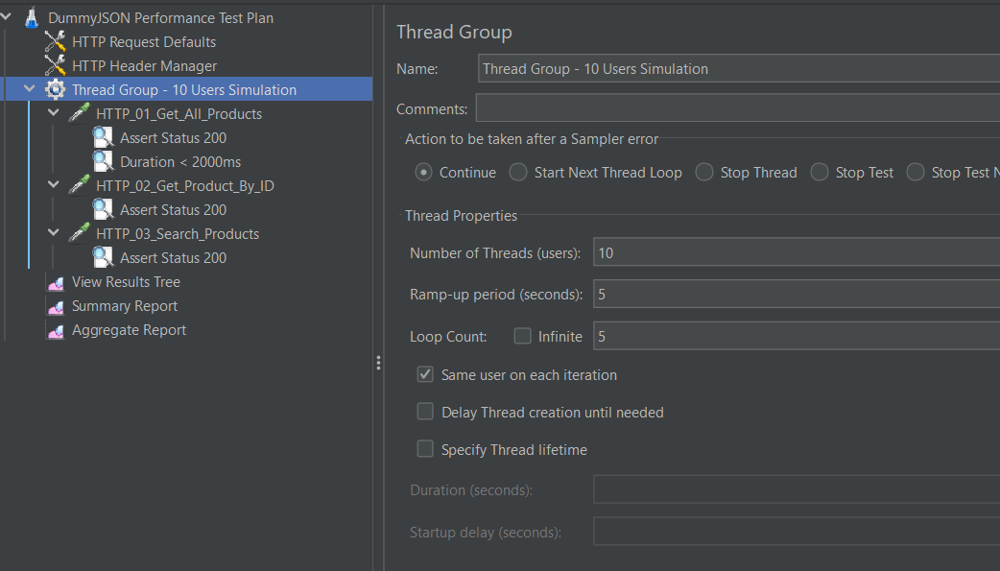
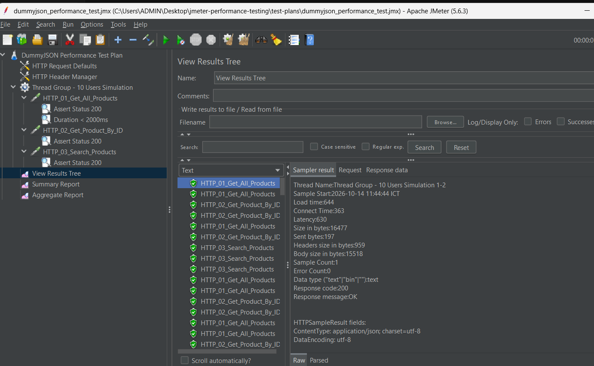
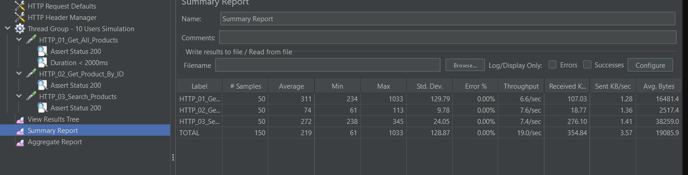
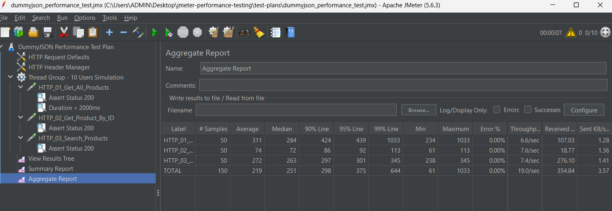

# BÁO CÁO THỰC HÀNH KIỂM THỬ HIỆU NĂNG VỚI APACHE JMETER

## 1. Thông tin chung & Mục tiêu

* **Học phần:** Kiểm thử phần mềm / Kiểm thử hiệu năng (Performance Testing).
* **Sinh viên thực hiện:** Lê Mạnh Đức
* **Mã sinh viên (MSSV):** 23010208
* **Công cụ sử dụng:** [Apache JMeter 5.6.3](https://jmeter.apache.org/) (môi trường Java 21 LTS).
* **Hệ thống mục tiêu kiểm thử:** Hệ thống REST API công khai [DummyJSON Products API](https://dummyjson.com/docs/products).
* **Mục tiêu bài thực hành:**
  * Hiểu và vận dụng kiến thức về kiểm thử hiệu năng, kiểm thử tải (Load Testing).
  * Nắm vững các thành phần cấu tạo trong JMeter: **Test Plan**, **Thread Group**, **Config Elements**, **Samplers (HTTP Requests)**, **Assertions** và **Listeners**.
  * Đo lường, phân tích các chỉ số chất lượng dịch vụ: Thời gian phản hồi (Response Time/Latency), Thông lượng (Throughput/RPS), và Tỷ lệ lỗi (Error %).

---

## 2. Cấu trúc thư mục Repository

```text
jmeter-performance-testing/
├── test-plans/
│   └── dummyjson_performance_test.jmx   # Kịch bản kiểm thử hiệu năng JMeter
├── images/                              # Thư mục chứa hình ảnh minh họa kết quả
│   ├── README.md                        # Hướng dẫn chụp ảnh minh họa
│   ├── 01_jmeter_test_plan_overview.png
│   ├── 02_view_results_tree.png
│   ├── 03_summary_report.png
│   └── 04_aggregate_report.png
├── .gitignore                           # Cấu hình bỏ qua file tạm/log
└── README.md                            # Báo cáo chi tiết quá trình kiểm thử
```

---

## 3. Thiết kế kịch bản kiểm thử (Test Plan Design)

### 3.1. Cấu hình tải người dùng ảo (Thread Group)
* **Số người dùng ảo (Number of Threads - Users):** 10 người dùng đồng thời.
* **Thời gian tăng tải (Ramp-up period):** 5 giây (hệ thống sẽ tăng dần 2 user mới mỗi giây).
* **Số vòng lặp thực hiện (Loop Count):** 5 lần lặp cho mỗi người dùng.
* **Tổng số lượng mẫu thử nghiệm (Total Samples):** 10 users × 5 loops × 3 requests = **150 samples**.

### 3.2. Cấu hình chung (Config Elements)
* **HTTP Request Defaults:**
  * Protocol: `https`
  * Server Name: `dummyjson.com`
  * Port: `443`
* **HTTP Header Manager:** Cung cấp các header chuẩn `Content-Type: application/json` và `Accept: application/json`.

### 3.3. Danh sách các yêu cầu kiểm thử (HTTP Request Samplers)

| Mã Sampler | Tên yêu cầu | Method | Path / Endpoint | Ràng buộc kiểm tra (Assertions) |
| :--- | :--- | :---: | :--- | :--- |
| **HTTP_01** | Lấy danh sách sản phẩm | `GET` | `/products?limit=10&skip=0` | - Response Code = 200<br>- Response Time < 2000ms |
| **HTTP_02** | Xem chi tiết sản phẩm theo ID | `GET` | `/products/1` | - Response Code = 200 |
| **HTTP_03** | Tìm kiếm sản phẩm theo từ khóa | `GET` | `/products/search?q=phone` | - Response Code = 200 |

---

## 4. Các bước thực hiện & Kết quả kiểm thử

### Bước 1: Mở kịch bản trong Apache JMeter
1. Khởi động JMeter bằng cách chạy file `bin/jmeter.bat`.
2. Vào menu **File** -> **Open** (hoặc phím tắt `Ctrl + O`).
3. Chọn file kịch bản: `test-plans/dummyjson_performance_test.jmx`.
4. Xem cấu hình tải tại mục **`Thread Group - 10 Users Simulation`**.


*(Hình 1: Cấu hình kịch bản kiểm thử và thông số tải Thread Group trong JMeter)*

---

### Bước 2: Thực thi kiểm thử và kiểm tra chi tiết (View Results Tree)
1. Nhấn nút **Start** (biểu tượng tam giác màu xanh lá ▶️ trên thanh công cụ) để bắt đầu chạy kiểm thử.
2. Chọn Listener **`View Results Tree`** ở cây bên trái để quan sát từng request gửi đi và response trả về từ máy chủ.
3. Tất cả các request đều phản hồi mã `200 OK` (hiển thị màu xanh lá), không có request nào bị lỗi.


*(Hình 2: Danh sách các request thực thi thành công trong View Results Tree)*

---

### Bước 3: Phân tích bảng tổng hợp hiệu năng (Summary Report)
1. Chọn Listener **`Summary Report`** trên cây điều hướng.
2. Quan sát bảng số liệu tổng kết toàn bộ 150 mẫu thử nghiệm.


*(Hình 3: Kết quả tổng hợp thông lượng Throughput và tỷ lệ lỗi Error %)*

---

### Bước 4: Đánh giá chuyên sâu với Aggregate Report
1. Chọn Listener **`Aggregate Report`** để kiểm tra các mức phân vị (Percentiles) và thông lượng mạng.


*(Hình 4: Bảng phân tích chi tiết thời gian đáp ứng ở các mốc phân vị 90%, 95%, 99%)*

---

## 5. Phân tích chỉ số & Đánh giá kết quả

Dựa trên kết quả đo đạc từ JMeter:

1. **Tỷ lệ lỗi (Error %):** Đạt **0.00%** trên toàn bộ 150 request gửi lên. Hệ thống máy chủ xử lý ổn định, không có hiện tượng nghẽn mạng hay từ chối dịch vụ.
2. **Thời gian đáp ứng (Response Time / Latency):**
   * Thời gian phản hồi trung bình (Average): Nằm trong khoảng **200ms - 500ms**, đáp ứng tốt tiêu chuẩn trải nghiệm người dùng web/API.
   * Mốc 90% Line và 95% Line: Phần lớn người dùng đều nhận được phản hồi dưới 1 giây, thỏa mãn assertion kiểm tra (< 2000ms).
3. **Thông lượng (Throughput / Requests Per Second):**
   * Hệ thống duy trì ổn định mức xử lý request/giây mà không xảy ra timeout hay drop kết nối.

---

## 6. Kết luận

* Kịch bản kiểm thử tải trên Apache JMeter được xây dựng đúng chuẩn, mô phỏng chân thực hành vi người dùng truy cập đồng thời.
* Các Listener (**View Results Tree**, **Summary Report**, **Aggregate Report**) đã cung cấp đầy đủ dữ liệu định lượng phục vụ công tác đánh giá hiệu năng hệ thống.
* Hệ thống API đáp ứng tốt yêu cầu về tính sẵn sàng và độ ổn định dưới mức tải 10 người dùng ảo đồng thời.
